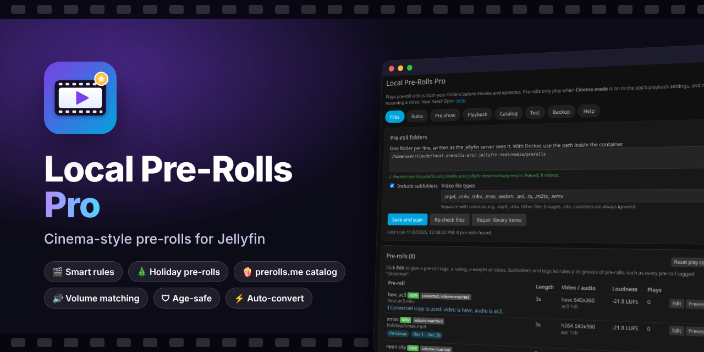
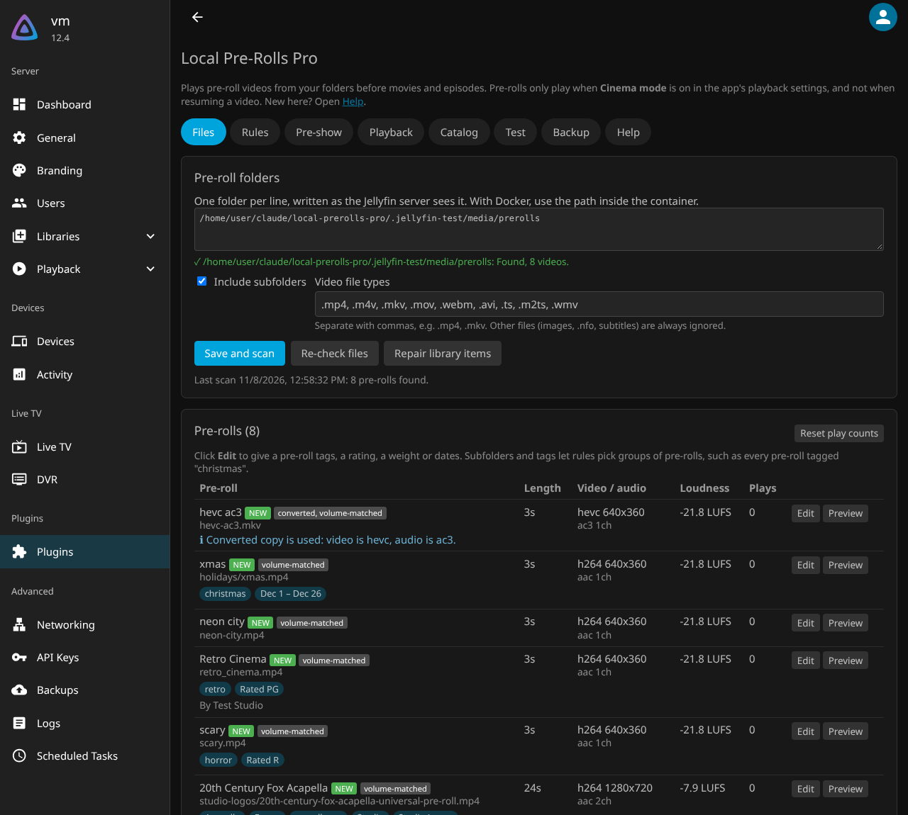
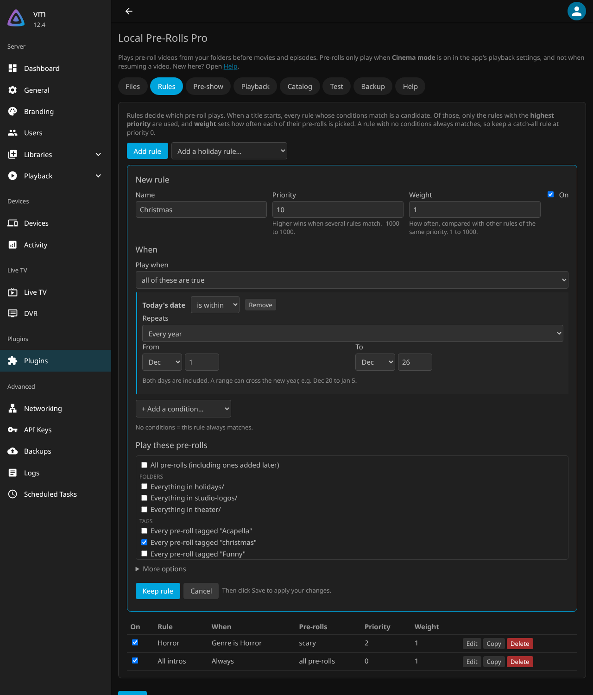
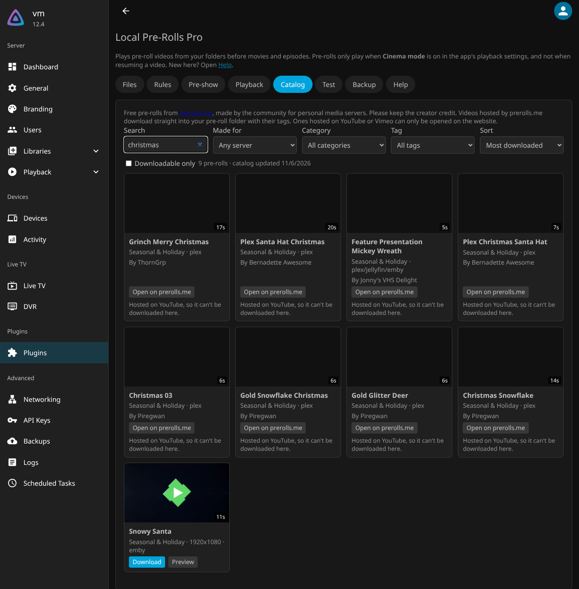
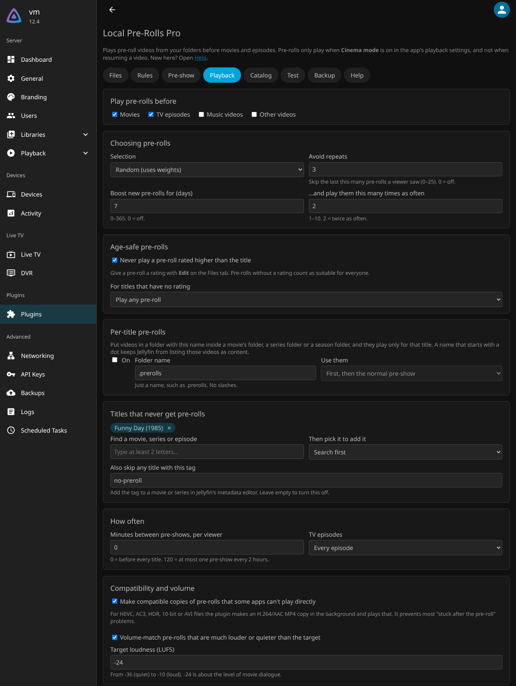
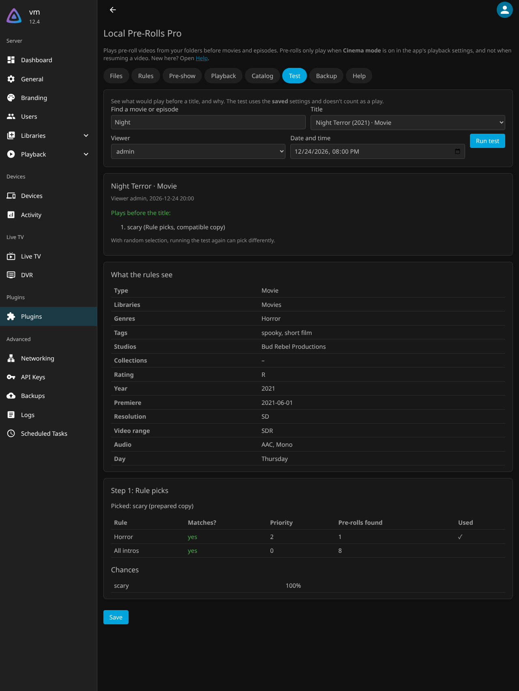
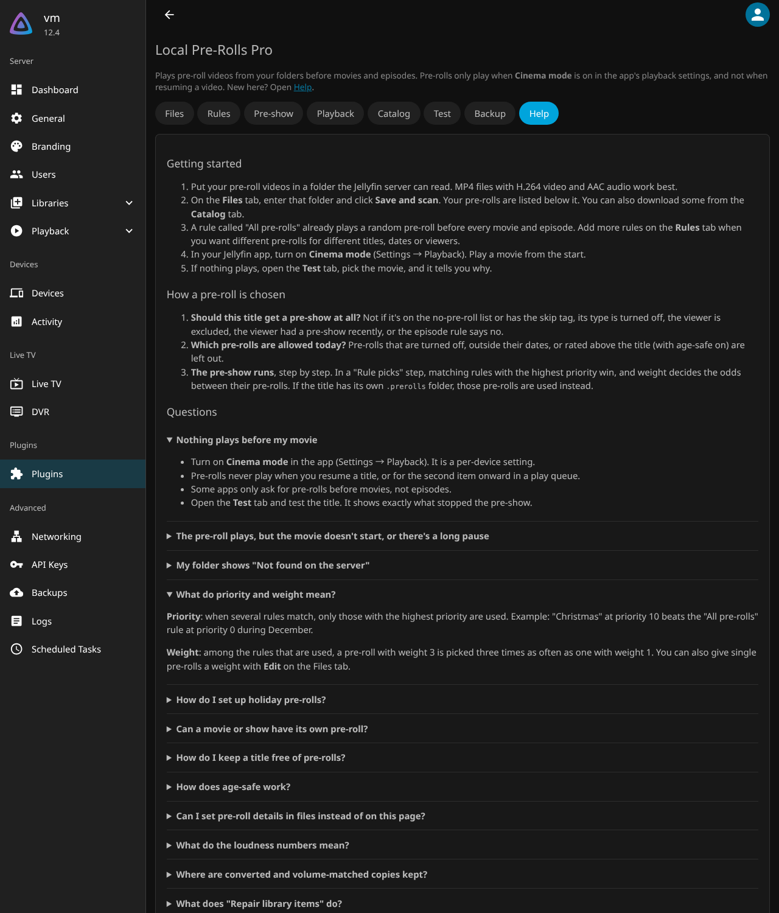

<p align="center">
  
</p>

<p align="center">
  <a href="https://github.com/modernharp/jellyfin-plugin-local-prerolls-pro/releases/latest"></a>
  <a href="https://github.com/modernharp/jellyfin-plugin-local-prerolls-pro/releases"></a>
  
  <a href="https://github.com/modernharp/jellyfin-plugin-local-prerolls-pro/actions/workflows/build.yml"></a>
  <a href="LICENSE"></a>
</p>

<h3 align="center">Play a short intro video before your movies and shows, just like at the cinema.</h3>

<p align="center">
  Use your own videos or hundreds of free ones from <a href="https://www.prerolls.me">prerolls.me</a>.<br>
  Christmas intros in December, a spooky one before horror films, a 4K one before 4K films, nothing scary before kids' shows. You decide.
</p>

---

## ⬇️ Download and install

Two ways. **Option A is easiest** and gives you automatic updates.

### Option A: install from inside Jellyfin (recommended)

1. In Jellyfin, go to **Dashboard → Plugins → Manage Repositories → New Repository**.
2. Enter any name (for example `Local Pre-Rolls Pro`) and this URL, then click **Add**:
   ```
   https://raw.githubusercontent.com/modernharp/jellyfin-plugin-local-prerolls-pro/main/manifest.json
   ```
3. Go back to **Plugins**, click **Available**, open **Local Pre-Rolls Pro** and click **Install**.
4. Restart Jellyfin (**Dashboard → Restart**). Done!

### Option B: download the zip

<p>
  <a href="https://github.com/modernharp/jellyfin-plugin-local-prerolls-pro/releases/latest/download/local-prerolls-pro.zip"></a>
</p>

Stop Jellyfin, unzip it into Jellyfin's `plugins` folder, and start Jellyfin again.

👉 **[Step-by-step install guide with pictures](docs/INSTALL.md)**, including Docker, Windows, Linux and macOS folders.

> **Important:** pre-rolls only play when **Cinema mode** is on in your Jellyfin app (**Settings → Playback → Cinema mode**), and only when you start a video from the beginning.

---

## ✨ What it can do

| | |
|---|---|
| 🎬 **Smart rules** | Pick pre-rolls by genre, tag, studio, actor, rating, library, collection, series, viewer, resolution (4K…), HDR / Dolby Vision, audio (Atmos, DTS:X…), date, weekday or time of day. |
| 🎄 **Holiday pre-rolls** | One click sets up Christmas, Halloween, New Year and more. They play only on those dates. |
| 🍿 **Free pre-roll catalog** | Browse prerolls.me inside Jellyfin, preview and download with one click, or follow a category and get new ones automatically. |
| 🎞️ **A real pre-show** | Chain several steps: a pre-roll, a few trailers of movies you haven't seen, then a "feature presentation" bumper. |
| 📁 **Per-movie pre-rolls** | Put a video in a `.prerolls` folder next to a movie or show and it plays only for that title. |
| 🛡️ **Age-safe** | An R-rated pre-roll never plays before a kids' film. |
| ⚡ **Plays everywhere** | Files that some apps can't play (HEVC, AC3, HDR…) get a compatible copy automatically, so playback doesn't get stuck after the pre-roll. |
| 🔊 **Even volume** | Every pre-roll's loudness is measured, and loud ones can be turned down to movie level. |
| 🔁 **Never boring** | Avoid repeats, boost new pre-rolls, or set one pre-show per binge, per day or every few hours. |
| 🧪 **Test tool** | Pick a movie and see exactly what would play, and why. |
| ❓ **Built-in help** | A Help tab with a getting-started guide and answers to common questions. Every setting is checked before saving, with clear messages. |
| 🔄 **Easy switch** | Used the Local Intros plugin? Import its settings in one click. |

## 📸 Screenshots

| Your pre-rolls | Rules | Free catalog |
|---|---|---|
|  |  |  |
| **Playback options** | **Test what plays** | **Built-in help** |
|  |  |  |

## 📚 Guides

- **[Install guide](docs/INSTALL.md)**: step by step, with pictures
- **[User guide](docs/GUIDE.md)**: set up your first pre-rolls, holiday rules and a full pre-show
- **[Questions and answers](docs/FAQ.md)**: nothing plays? stuck after the pre-roll? start here
- **[Changelog](CHANGELOG.md)**: what's new in each version

## 💬 Help and feedback

Found a bug or have an idea? [Open an issue](https://github.com/modernharp/jellyfin-plugin-local-prerolls-pro/issues/new/choose). If pre-rolls don't play as expected, include what the plugin's **Test** tab says. It usually shows the reason.

## 🙏 Credits

- Built on the [Local Intros](https://github.com/jellyfin/jellyfin-plugin-intros) plugin by the Jellyfin team, BrianCArnold and dkanada.
- Free pre-rolls by the [prerolls.me](https://www.prerolls.me) community. Please keep the creator credits. The clips are meant for personal media servers.
- Not affiliated with the Jellyfin project.

## 🛠️ For developers

See [CONTRIBUTING.md](CONTRIBUTING.md) for building, the code layout, and the test suites: 65 unit tests, 36 live API checks, and 59 click-through checks that use every setting in a real browser against a real Jellyfin server.

## License

[GPL-3.0](LICENSE), like the plugin it is based on.
