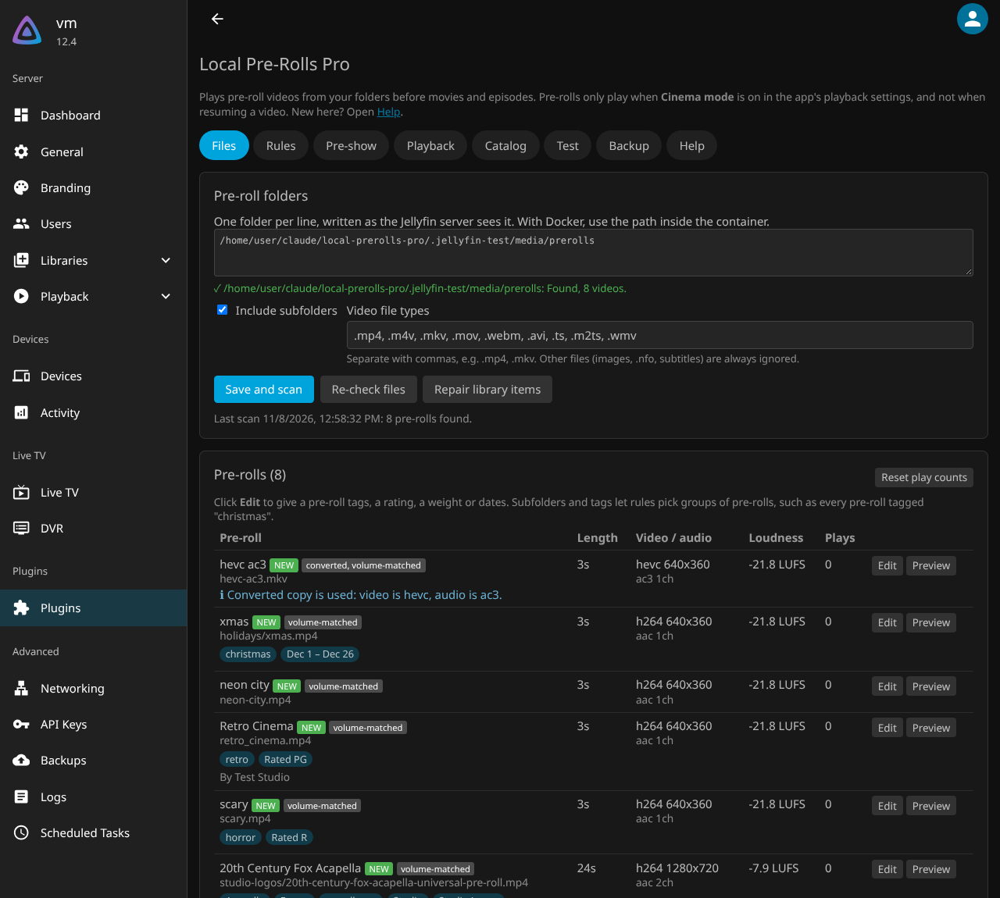
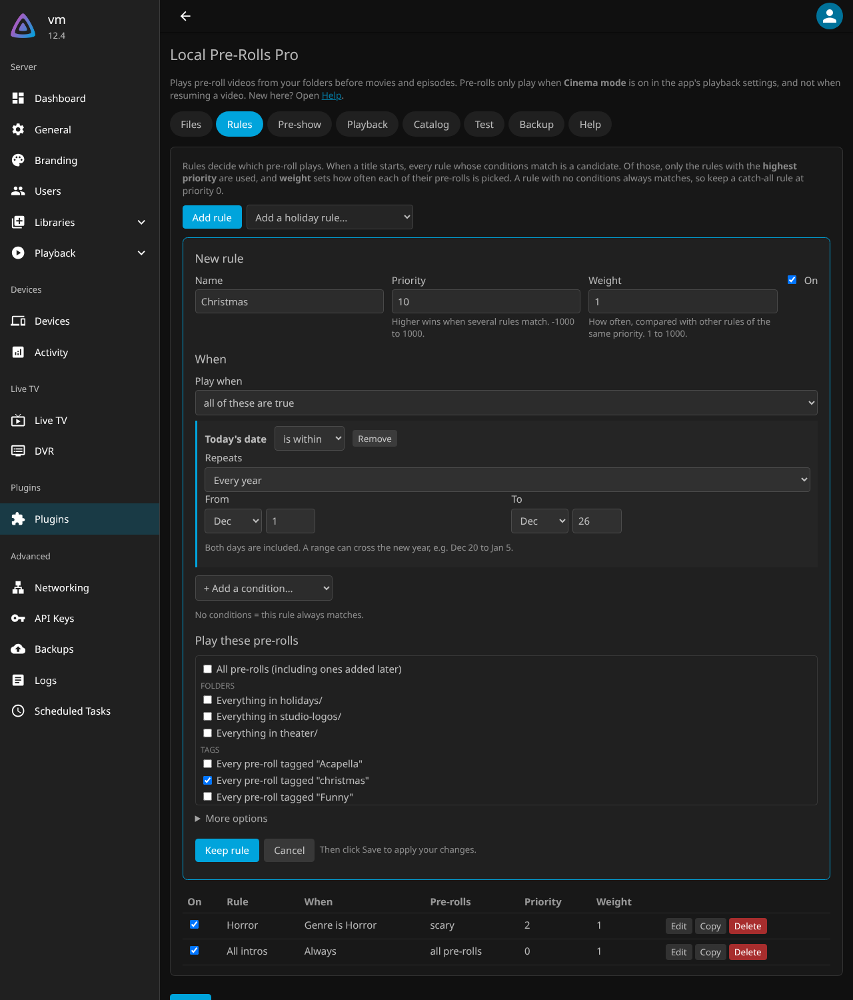
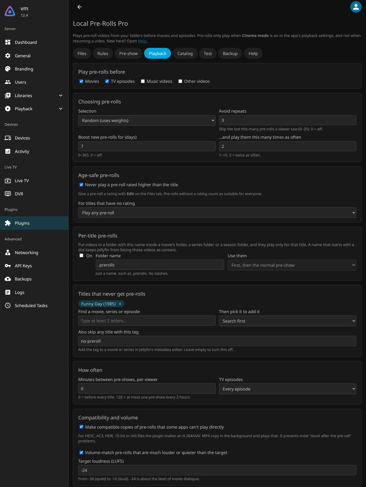
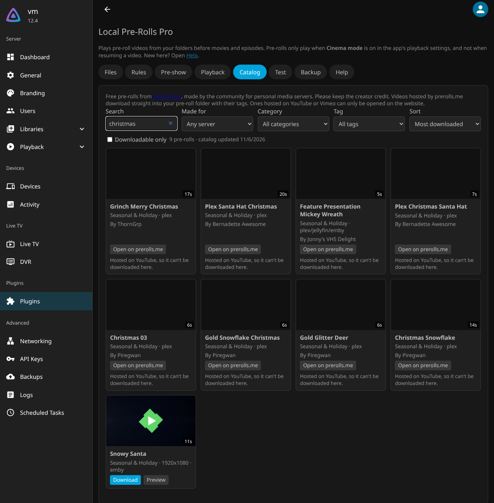
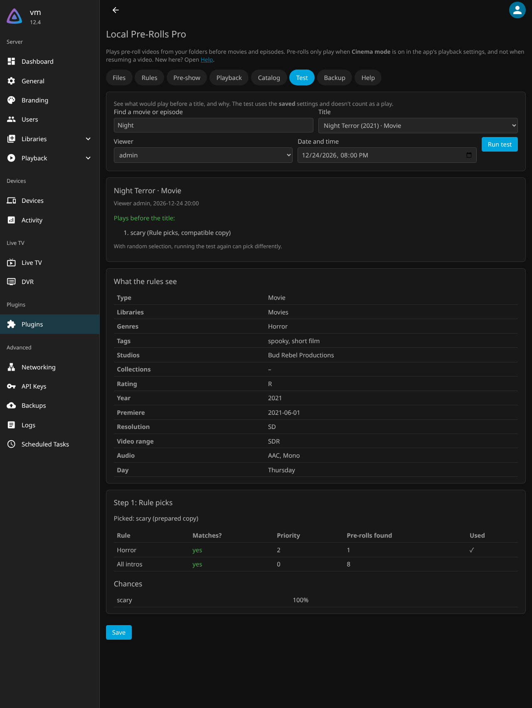
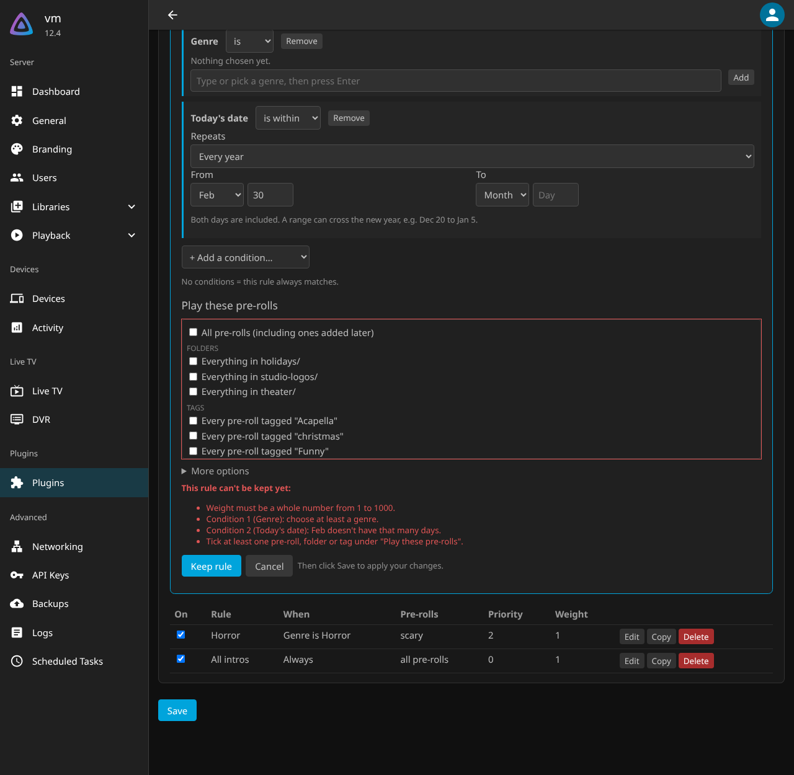

# User guide

A tour of the plugin, from your first pre-roll to a full cinema-style pre-show. Open it at **Dashboard → Plugins → Local Pre-Rolls Pro**.

## 1. Add your pre-rolls (Files tab)

Type the folder that holds your pre-roll videos and click **Save and scan**. Subfolders work as groups, for example `holidays/` or `studio-logos/`.

Each pre-roll shows its length, codecs and loudness. Click **Edit** to give it:

- **Tags** that rules can pick by, such as "christmas"
- A **rating**, so it never plays before titles rated lower
- A **weight**, to make it play more or less often
- **Dates**, so it only plays at certain times of the year
- **Plays: Never**, to switch it off without deleting it

Badges show **NEW** (new pre-rolls play more often for a week) and **converted** or **volume-matched** (a fixed copy plays instead of the original).

## 2. Choose what plays when (Rules tab)

A fresh install has one rule, **All pre-rolls**, which plays a random pre-roll before everything. Add more rules for special cases.

A rule has:

- **Conditions** (*when*), for example "Genre is Horror", "Today's date is between Dec 1 and Dec 26", "Resolution is 4K" or "Viewer is Kids"
- **Pre-rolls** (*what*): single files, whole folders, every pre-roll with a tag, or all of them
- **Priority**: higher wins when several rules match
- **Weight**: how often, compared with other rules of the same priority

Use **Add a holiday rule** for ready-made Christmas, Halloween, New Year and more.

## 3. Build a pre-show (Pre-show tab)

Instead of one pre-roll, play a sequence, for example:

1. **Rule picks**: one pre-roll chosen by your rules
2. **Trailers**: two trailers of movies the viewer hasn't watched
3. **Fixed pre-rolls**: your "feature presentation" bumper, every time

Each step can be limited to movies, episodes and so on.

## 4. Fine-tune (Playback tab)

- Which kinds of videos get pre-rolls
- Random, least played or in order; avoid repeats; boost new pre-rolls
- Age-safe pre-rolls
- Per-title pre-rolls from a `.prerolls` folder
- Titles and viewers that never get pre-rolls
- How often: minutes between pre-shows, and only the first episode of a binge
- Compatible copies and volume matching

## 5. Get free pre-rolls (Catalog tab)

Search hundreds of free pre-rolls from prerolls.me. Click **Preview** to watch, and **Download** to save into your pre-roll folder with tags and credit. Under **Subscriptions**, follow a category or tag and new pre-rolls download automatically.

## 6. Check what will play (Test tab)

Pick a title, a viewer and a date. The test shows what would play, the chance of each pre-roll, and why each rule or file was used or left out. It's the quickest way to understand your rules.

## 7. Back up your settings (Backup tab)

Download all your settings as a file, restore them later, or import settings from the Local Intros plugin.

## Mistakes are explained

If something is missing or out of range, nothing is saved. The field turns red with a short explanation, and a summary at the top lists every problem with a **Show me** link.

