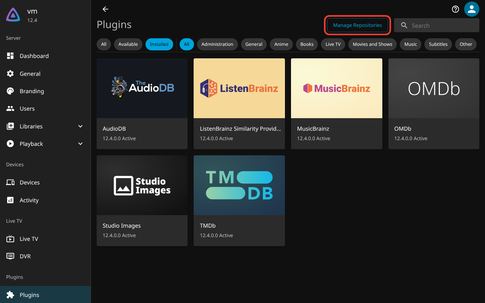
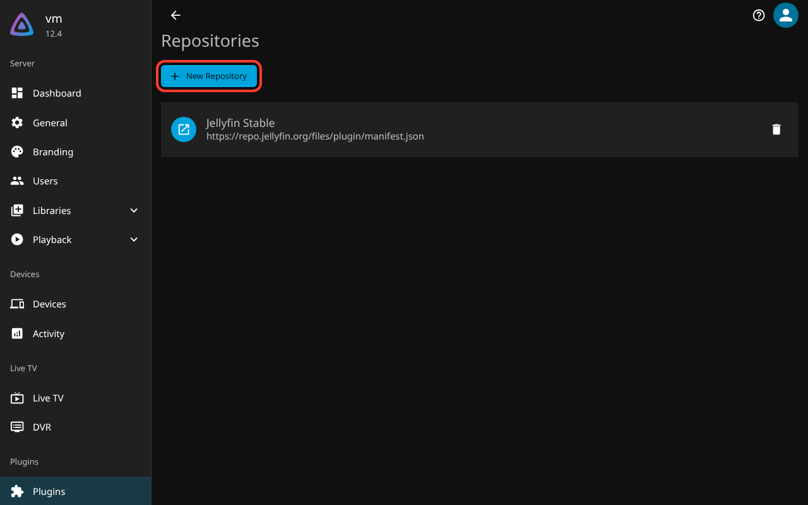
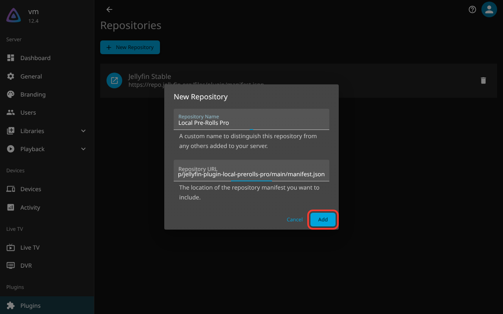
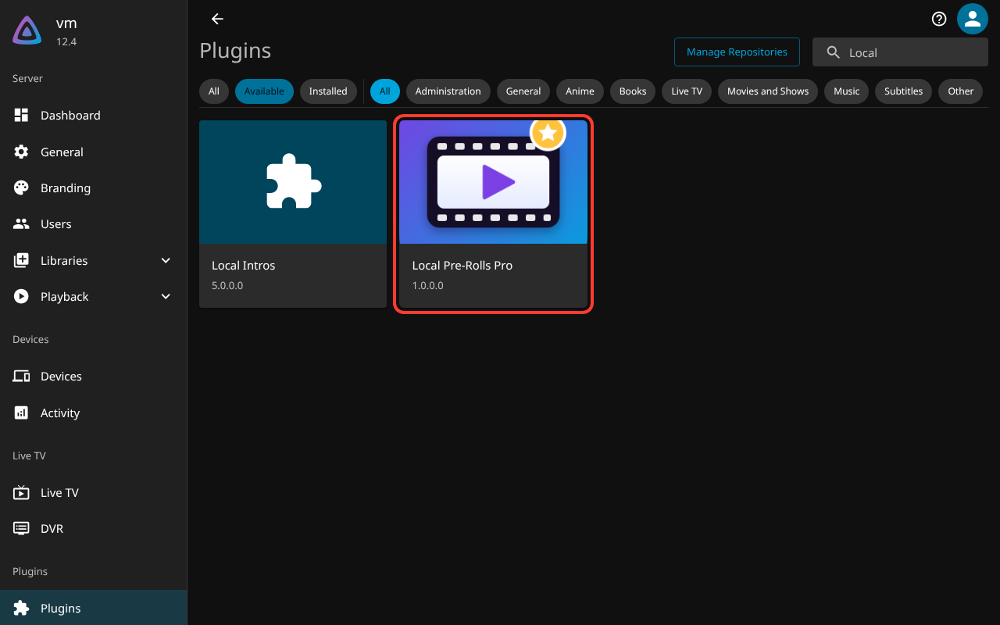
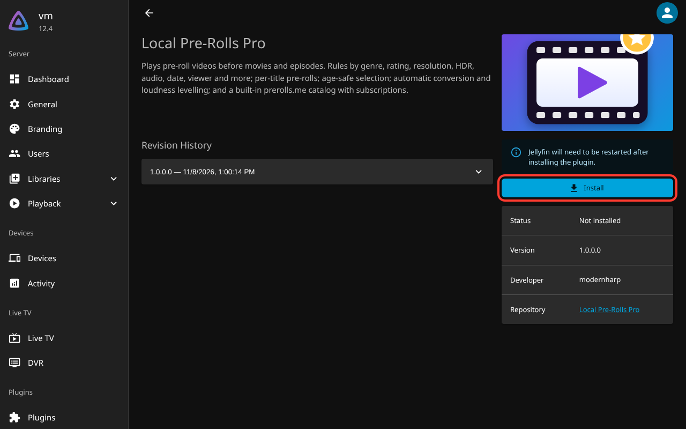
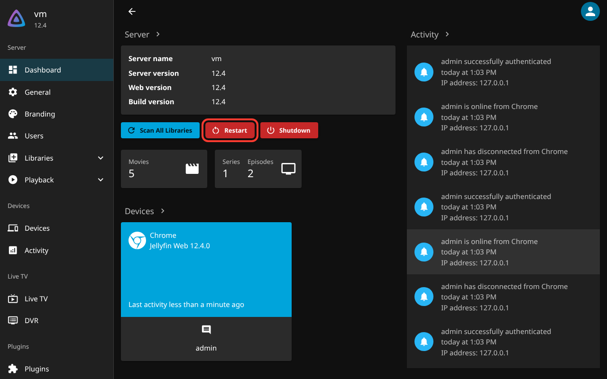
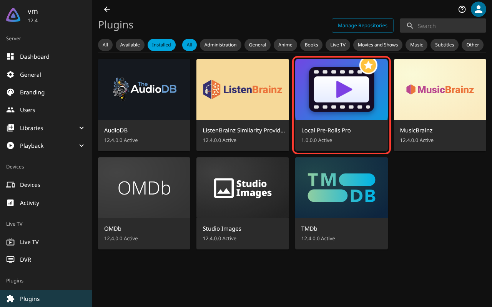
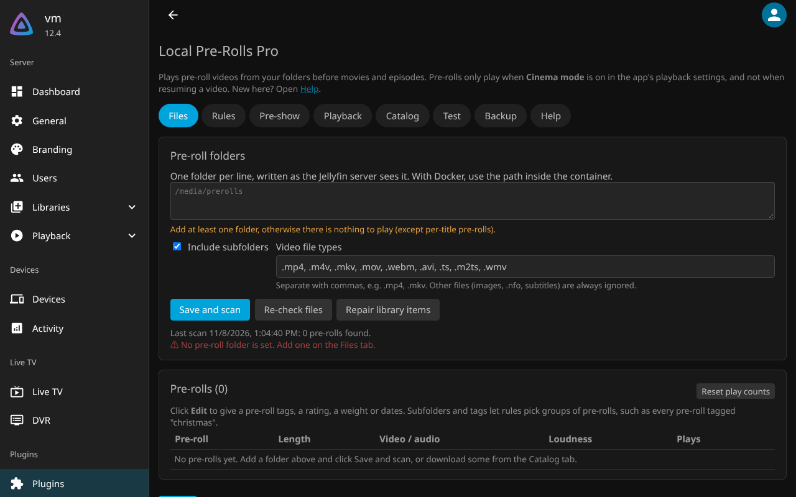

# Install Local Pre-Rolls Pro

You need **Jellyfin 12** and an administrator account. Installing takes about two minutes.

There are two ways to install:

- **[Option A: from inside Jellyfin](#option-a-install-from-inside-jellyfin-recommended)**. Easiest, and updates install automatically.
- **[Option B: download the zip](#option-b-download-the-zip)**. For servers that can't reach GitHub.

---

## Option A: install from inside Jellyfin (recommended)

### 1. Open the plugin page

In Jellyfin, open the menu and go to **Dashboard → Plugins**. Click **Manage Repositories** at the top.



### 2. Add a new repository

Click **New Repository**.



### 3. Enter the address

- **Repository Name**: anything you like, for example `Local Pre-Rolls Pro`
- **Repository URL**: copy and paste this exactly:

```
https://raw.githubusercontent.com/modernharp/jellyfin-plugin-local-prerolls-pro/main/manifest.json
```

Click **Add**.



### 4. Find the plugin

Go back to **Plugins** and click **Available**. Find **Local Pre-Rolls Pro**; typing "Local" in the search box helps. Click it.

> Make sure you pick **Local Pre-Rolls Pro** (the purple film icon), not the older "Local Intros".



### 5. Install

Click **Install**.



### 6. Restart Jellyfin

Go to **Dashboard** and click **Restart**. On some systems you restart the Jellyfin service or Docker container instead.



### 7. Check it's installed

After the restart, **Dashboard → Plugins** shows **Local Pre-Rolls Pro** as *Active*.



New versions now show up in Jellyfin by themselves, and install on restart if automatic updates are on.

---

## Option B: download the zip

1. **[Download the latest version](https://github.com/modernharp/jellyfin-plugin-local-prerolls-pro/releases/latest/download/local-prerolls-pro.zip)** (`local-prerolls-pro.zip`).
2. **Stop Jellyfin.**
3. In Jellyfin's `plugins` folder, create a folder named `LocalPrerollsPro` and unzip the download into it. You should end up with:
   ```
   plugins/LocalPrerollsPro/Jellyfin.Plugin.LocalPrerollsPro.dll
   plugins/LocalPrerollsPro/meta.json
   plugins/LocalPrerollsPro/logo.png
   ```
4. **Start Jellyfin.**

Where is the `plugins` folder?

| Jellyfin installed with | Plugins folder |
|---|---|
| Docker | `plugins` inside the folder you mapped to `/config` (for linuxserver.io images: `/config/data/plugins`) |
| Linux (Debian, Ubuntu, Fedora package) | `/var/lib/jellyfin/plugins` |
| Windows | `C:\ProgramData\Jellyfin\Server\plugins` |
| macOS | `~/.local/share/jellyfin/plugins` |

To update later, repeat these steps with the new zip and delete the old version's folder.

---

## First steps after installing

Open **Dashboard → Plugins → Local Pre-Rolls Pro**.



1. Under **Pre-roll folders**, type the folder with your pre-roll videos, as the Jellyfin server sees it. With Docker, that's the path *inside* the container. A green ✓ shows the folder was found.
2. Click **Save and scan**. Your pre-rolls appear in the list.
3. No pre-rolls yet? Open the **Catalog** tab and download some for free.
4. In your Jellyfin app, turn on **Cinema mode** (**Settings → Playback**). Then play a movie from the start.

Something not working? Open the plugin's **Help** tab, or see **[Questions and answers](FAQ.md)**.

## Coming from Local Intros?

Open the **Backup** tab and click **Import Local Intros settings**. Then disable or uninstall Local Intros (**Dashboard → Plugins → Local Intros**), otherwise both plugins add pre-rolls.

## Uninstall

**Dashboard → Plugins → Local Pre-Rolls Pro → Uninstall**, then restart Jellyfin. Your pre-roll videos are not touched.
